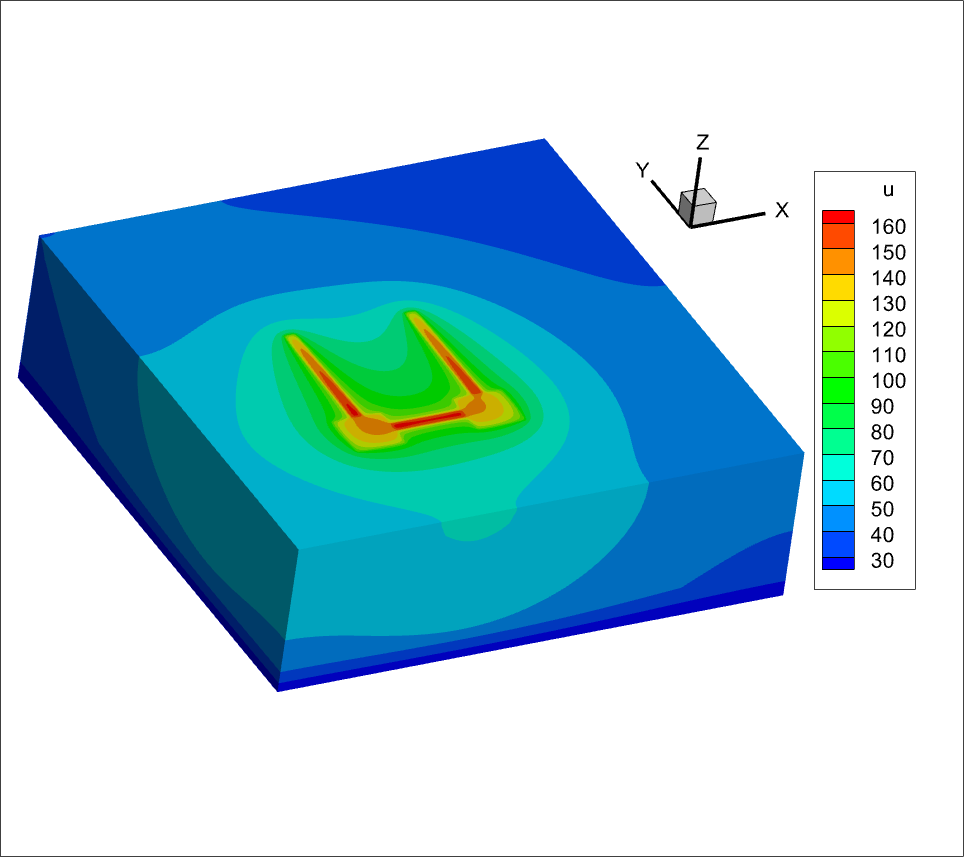

Предназначение - оперативный расчёт теплового соротивления на корпус планарных струкур.

Системные требования - В системе должен быть установлен  Tecplot 360 EX 2023 R1.

Ограничения. 1. запись результата в файл ведется в текстовом виде поэтому объем 
выходных данных (количество узлов по x и y) должно быть невелико. Это ограничение записи 
результата в текстовый формат, а не ограничение солвера. 2. Ограничение метода БПФ - равномерный 
шаг сетки в плоскости где рисуется топология. Не рисуйте слишком много, контролируйте расходование
 ресурсов вашей ЭВМ.

Использование. После создания тологии, задания мощности тепловыделения, назначения слоёв подложки.
Можно нажать Solve-Run (предварительно сохранившись) и солвер отработает молча и запустит в конце Tecplot
(именно тот Tecplot который указан в требованиях).

Требования к ОС: Win 10 x64 only
Написано в Visual Studio 2019 community

Это приложение не имеет статус релиза, используйте на свой страх и риск.
